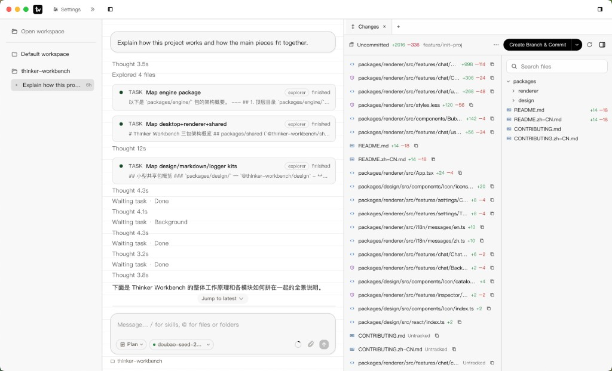

# Thinker Workbench

[English](../README.md) | **简体中文**

许可证：[Apache-2.0](../LICENSE) · 暂缓事项：[TODOS](./TODOS.zh-CN.md)

## 项目说明

Thinker Workbench 是面向本地仓库的 AI 编程桌面端。你在工作区里对话，agent 可以读改文件、执行 Shell；会话、设置与密钥留在本机，模型走你自己配置的 OpenAI 兼容端点。

日常能力大致包括：

- **多模式**：Agent 改代码，Ask 只读答疑，Plan 先出方案再动手
- **并行 Task 与子代理**：把大任务拆开跑，时间线里跟进度
- **Changes 与 diff**：和聊天同屏核对改动，而不是只看最终文字
- **Skills、Rules、MCP**：按全局或工作区扩展行为；`/` 选 skill，`@` 引用文件
- **本机数据**：默认目录 `~/.thinker`，API key 经系统 `safeStorage` 保管



## 环境要求

| | |
|---|---|
| **Node.js** | 22+ |
| **pnpm** | **11.12.0**（由 `packageManager` 固定 — 不要用 npm/yarn） |
| **操作系统** | Windows / macOS / Linux |
| **Electron** | 37（workspace 依赖） |

`pnpm install` 会跑 `postinstall`（macOS 会重命名 Electron.app 以区分本地身份；desktop 会重建 `better-sqlite3` 等原生模块）。

## 快速开始

```bash
pnpm install
pnpm run dev
```

1. 等待桌面窗口出现（renderer：http://127.0.0.1:5179）。
2. 打开 **设置 → 模型**，填入 API key、base URL、model。
3. 打开或创建工作区，开始对话。

常用参数：

```bash
pnpm run dev -- --no-hot      # 关闭 Vite HMR / Electron 自动重启  (TW_DEV_NO_HOT=1)
pnpm run dev -- --devtools    # 启动时打开 DevTools              (THINKER_OPEN_DEVTOOLS=1)
```

> 仅跑 renderer（`pnpm --filter @thinker-workbench/renderer dev`）没有 `window.thinker` 桥 — 聊天请用完整的 `pnpm run dev`。

## 常用脚本

| 脚本 | 用途 |
|---|---|
| `pnpm run dev` | 全栈：watchers + Electron |
| `pnpm run build` / `build:node` | 构建全部包 / 跳过 renderer |
| `pnpm start` | 用最近一次构建启动 Electron |
| `pnpm test` / `test:report` | Vitest（报告 → `test-results/report/`） |
| `pnpm run check` | Biome lint + format 检查 |
| `pnpm run format` / `lint` | 仅格式化写入 / 仅 lint |
| `pnpm run pack:zip` | 打包仓库 zip（遵循 `.gitignore`） |
| `pnpm run stage:desktop` | 组装 `.stage/app` + `.stage/payload`（需先 `pnpm build`） |
| `pnpm run pack:desktop` | build → stage → electron-builder 打当前 OS 目标 |
| `pnpm run pack:desktop:win` / `pack:desktop:mac` | 仅 Windows / 仅 macOS 目标 |
| `pnpm run pack:desktop:dir` | 同上但 `--dir`（只出未封装应用目录） |

安装包产物在仓库根目录 `release/`。打包布局：Shell 在 `app.asar`，Payload 在 `Resources/payload/`（`layout.json` + renderer/engine/bundled）。`pack:zip` 只是源码 zip，不是桌面安装包。

CI：`.github/workflows/pack.yml` 在 `windows-latest` / `macos-latest` 上分别打包，触发为 **手动 workflow_dispatch** 或推送 **`v*` tag**；产物以 Actions artifact 上传（`thinker-workbench-win` / `thinker-workbench-mac`）。未配置签名证书时产出未签名包。

**Windows 打包与签名工具链：** `electron-builder` 会下载并解压 `winCodeSign`（用于改 exe 资源，以及在有证书时做 Authenticode）。该压缩包含符号链接；若报 `Cannot create symbolic link` / 客户端没有所需特权，请开启 **设置 → 系统 → 开发者选项 → 开发人员模式**（或管理员终端），然后删除 `%LOCALAPPDATA%\electron-builder\Cache\winCodeSign` 后重跑 `pnpm run pack:desktop`。未配置代码签名证书时仍会走该工具链写资源信息；正式分发请自行配置证书。macOS 公证见 `notarize-hint`。

测试在各包 `tests/`（镜像 `src/`），命名 `*.test.ts`。配置：[`vitest.config.ts`](../vitest.config.ts)。单包：`pnpm --filter @thinker-workbench/<pkg> test`。

## 架构

```
Renderer (React / Vite)
    │  preload → window.thinker
    ▼
Desktop (ipcMain) ── SQLite / settings / FS IPC
    │
    └── AgentBridge ── utilityProcess
                          └── engine/artifacts/entry.js
                                UtilityHost → AgentRuntime → LangGraph StateGraph
```

| 层 | 包 | 职责 |
|---|---|---|
| UI | `renderer` | 聊天、设置、工具面板 |
| Shell | `desktop` | Electron main、preload、IPC、SQLite |
| Agent | `engine` | LangGraph 图、工具、模型客户端 |
| Kit | `design` / `markdown` | 共享 UI + Markdown |
| 契约 | `shared` | IPC channel、命令、事件 |
| 可观测 | 本机自建 | 设置 → 数据开关。控制台内类 LangSmith 的 run 树 / 瀑布 / 入参出参。无需 Docker 或云账号。 |

默认图：`packages/engine/src/graph/` 中 LangGraph `START → agent ⇄ tools → END`。Checkpoint 为 SqliteSaver（`<dataDir>/workspaces/<id>/checkpoints/langgraph.sqlite`）。文件工具作用在 **工作区根目录**，不是 monorepo cwd。UI 优先用 `@thinker-workbench/design/react`；应用内目录页 `#/components`。

构建产物在各包 `artifacts/`（已 gitignore）。冷启动缺产物时由 `scripts/dev-prepare.mjs` 准备。

## macOS 钥匙串弹窗

API Key 经 Electron `safeStorage` 加密，钥匙串条目名为 **Thinker Workbench Safe Storage**。系统会在**真正需要解密已存密钥**时（发消息 / Resume、探测模型）要求输入**登录钥匙串密码**。启动、打开设置、上下文占用估算**不会**触碰钥匙串。

开发态 / 未签名包常提示「不能验证真实性」，因为每次 rebuild 应用身份可能变化。信任本地构建可选 **始终允许**；**拒绝**则解不开已存 Key，模型调用会失败。

## 数据目录

默认根目录：**`~/.thinker`**（`general.dataDir`）。权威 `settings.json` 在该根下；自定义 `dataDir` 时仍会在 `~/.thinker/settings.json` 留镜像，以便下次启动找到它。

路径只在 `packages/shared/src/dataLayout.ts` 声明一次（desktop 与 engine 共用）：每条记录包含相对路径 + 分类（`config` / `state` / `workspace` / `content` / `cache`）+ 清理策略，迁移清单、清理任务与测试断言都由这张表派生。

| 路径 | 分类 | 内容 |
|---|---|---|
| `settings.json` | config | 设置（模型密钥、偏好、`dataDir`） |
| `state/catalog.db` | state | 工作区元数据 |
| `state/session.json` | state | UI / 窗口会话 |
| `workspaces/<id>/chat.db` | workspace | 按工作区的聊天 |
| `workspaces/<id>/images/`、`attachments/` | workspace | 聊天附图 / 外部文件附件 |
| `workspaces/<id>/shell-output/` | workspace | 终端大输出 spill |
| `workspaces/<id>/checkpoints/` | workspace | Agent 恢复检查点 |
| `workspaces/<id>/memory.sqlite` | workspace | 会话记忆 |
| `workspaces/<id>/trace/` | workspace | Trace 索引库 + 会话载荷 jsonl |
| `workspaces/ws_default/project/` | content | 内置默认工作区根（id 固定） |
| `customize/{rules,skills,agents,mcps}/` | content | 全局 rules / skills / subagents / MCP |
| `cache/browser-screenshots/`、`cache/computer/images/` | cache | 可再生截图（按天数 + 总大小清理） |

删除工作区会整目录带走 `workspaces/<id>/`（聊天、附图、附件、检查点、trace、记忆）。默认工作区（`ws_default`）不可删除，只能清空会话。

更换根目录会把历史 **复制** 到新文件夹（旧根保留），并始终在该处写入 `settings.json`。

## 检查点：分支与回退

一个 **检查点（Checkpoint）** = 一轮 agent run 的完整可恢复状态，包含两层：

| 层 | 存储 | 归谁写 | 恢复执行者 |
|---|---|---|---|
| 对话态 | `workspaces/<id>/checkpoints/langgraph.sqlite` + `threads.json` | engine（LangGraph SqliteSaver） | engine（resume，可带 `checkpoint_id` 从中间 superstep 续跑） |
| 文件态（跟踪） | `workspaces/<id>/checkpoints/files/<runId>/` | engine（文件工具写入前捕获前像） | desktop（写回工作区，临时文件 + rename） |
| 文件态（git 兜底） | git 临时 ref（`git stash create`） | desktop（run 开始时） | desktop（先 git 后前像） |

**轮（turn）** = 一条用户消息 + 其助手回复 = 一个 agent run。时间线按轮聚合（prompt、模型、token、耗时、状态、工具数、文件徽章），每轮可展开 superstep 快照并从中点续跑。

| 操作 | 语义 | 破坏性 |
|---|---|---|
| **分叉（Fork）** | 复制前 N 轮到新会话（新 thread），原会话原样保留 | 非破坏 |
| **撤销（Undo）** | 恢复该轮文件快照 + 回退对话到该轮之前 | 破坏式，需键入「撤销」确认 |
| **对比（Compare）** | 同源两分支逐轮对齐（文本行级 + 用量差 + 汇总） | 只读 |

覆盖范围（**默认组合，非 git 仓库时 UI 明示**）：文件工具（`write_file` / `edit_file` / `delete_file`）写入前捕获前像；git 仓库额外用全量 ref 兜底 shell / MCP 造成的改动。单文件 > 5MB、`.git/` 内、符号链接一律跳过并在 manifest 记 `skipped`。

保留策略（三者取严，任一超限即从最旧开始清理）：每工作区 30 个 run、14 天、256MB、单文件 5MB。**永不清理**：正在运行的 run、会话待恢复的 run、每个会话最近 1 个 run。对话态快照的删除经 engine 子进程执行（desktop 直删会因 Windows 文件锁静默失败）；文件前像为纯数据文件，由 desktop 直删。

入口：右侧检查器标签条的「+」菜单 → 打开「时间线」标签；面板内每轮行的「⋯」菜单可撤销 / 分叉，表头的「对比分支」按钮做同源对比。保留阈值**尚未接入设置页**，需要时在 DevTools 控制台调 `window.thinker.checkpoints.getRetention()` / `setRetention(...)` / `pruneNow()`。

## Rules、Skills、输入框

| 类型 | 查找顺序（后者覆盖同名） |
|---|---|
| **Rules** | `<dataDir>/customize/rules/` → `<workspace>/.thinker/rules/` |
| **Skills** | `<dataDir>/customize/skills/` → `<workspace>/.thinker/skills/` |

Rules：`.md` / `.mdc` / `.txt`。Skills：目录 + `SKILL.md`（YAML frontmatter）。

聊天输入框：

- **`/`** — 选择 skill，插入 `/skill-name `（引擎按该形式激活）。
- **`@`** — 提及工作区文件或文件夹；发送时文件注入上下文（文件夹：列表 + 若干小文本）。Esc / 空格关闭选择器并保留普通 `@`。

## MCP（stdio）

**设置 → MCP**。合并顺序（同 `id` 后者覆盖）：

1. `<dataDir>/customize/mcps/*.json`
2. `<workspace>/.thinker/mcps/*.json`
3. 可选从 `mcp.json` 导入（`mcpServers` map）

字段：`id`、`name`、`enabled`、`transport: "stdio"`、`command`、`args`、`env`、可选 `cwd`。工具名为 `mcp__{serverId}__{toolName}`。

Windows 下 `npx` / `npm` / `node` 会自动解析为 `*.cmd`。

```json
{
  "id": "filesystem",
  "name": "Filesystem",
  "enabled": true,
  "transport": "stdio",
  "command": "npx",
  "args": ["-y", "@modelcontextprotocol/server-filesystem", "C:/path/to/workspace"],
  "env": {}
}
```

在设置中禁用服务器即可卸掉其工具；退出后不应留下孤儿 MCP 子进程。

## 贡献

分支、评审与合入约定见 **[CONTRIBUTING.zh-CN.md](./CONTRIBUTING.zh-CN.md)**（[English](../CONTRIBUTING.md)）。暂缓项：[TODOS.zh-CN.md](./TODOS.zh-CN.md)。
